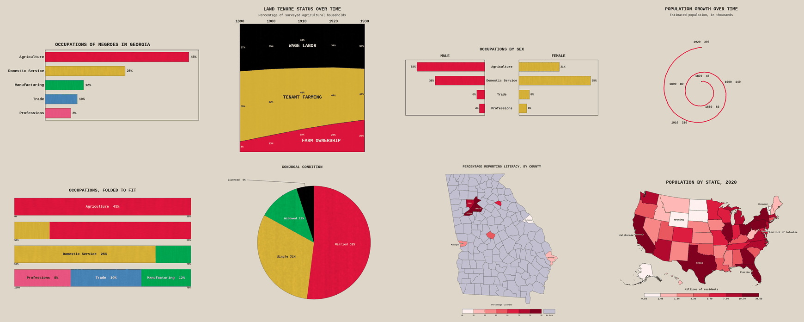

# dubois-charts

Charts in the style of W.E.B. Du Bois's data portraits, for your own data.



## Historical Context

In 1900, W.E.B. Du Bois and his team at Atlanta University created 63 innovative hand-painted data visualizations for the "Exposition Universelle" in Paris. These charts challenged racist assumptions and powerfully demonstrated African American progress in the 35 years since emancipation. The visualizations were revolutionary in their use of:

- Bold, saturated colors from a limited palette
- Creative chart types (spirals, wrapped bars, butterfly charts)
- Compelling visual narratives
- Hand-crafted aesthetic with visible brushstrokes
- Modernist design principles decades before the modernist movement

This package draws charts in that style with matplotlib, from whatever
data you bring: bar, stacked area, butterfly, spiral, snake and pie
charts, and maps of U.S. counties and states. Every title, label and
callout is sized from measurements of the actual text, so long names,
many categories and awkward data lay out cleanly without hand-tuning.

## Installation

dubois-charts isn't on PyPI yet. Install it from its repository:

```bash
pip install git+https://github.com/shalinialisha/dubois-charts.git
```

or from a copy of it:

```bash
git clone https://github.com/shalinialisha/dubois-charts.git
pip install ./dubois-charts
```

The repository is private for now, so this works for people who've been
given access to it, signed in to GitHub as git signs in -- or over SSH,
with `git+ssh://git@github.com/shalinialisha/dubois-charts.git`.

It needs Python 3.10 or newer, and installs matplotlib, numpy and scipy.
It isn't the `dubois` package on PyPI -- a set of Du Bois color palettes
and a matplotlib style, by David White -- and the two can be installed
side by side.

## Quick Start

```python
import dubois_charts as dc

fig = dc.bar_chart(
    categories=['Agriculture', 'Manufacturing', 'Trade', 'Professions'],
    values=[45, 25, 20, 10],              # made-up numbers, as in every example here
    title='Occupations of Georgia Negroes',
    value_format='{:.0f}%',
    sort_descending=True,
)
fig.savefig('occupations.png')
```

Every chart function returns a matplotlib `Figure`; `save_path='...'`
saves it as well. [The tutorial](docs/tutorial.ipynb) goes through every
chart type with data of the shapes people actually have: a pandas
DataFrame, Census county codes, dates, long names, many rows.

## Chart Types

Eight general-purpose chart functions take your own data directly --
arbitrary categories, arbitrary series, titles of any length -- and size
everything from real measurements at render time rather than requiring
you to hand-tune font sizes. See
`dubois_charts/charts/GENERAL_ENGINE_README.md` for how that fitting works and
what testing against deliberately long/adversarial inputs found and fixed
in each one. The numbers in these examples are made up, to show what each
chart does; the state populations are the 2020 census's, rounded.

### `bar_chart()` -- horizontal bars, single or grouped series

```python
import dubois_charts as dc

dc.bar_chart(
    categories=['Agriculture', 'Domestic Service', 'Manufacturing', 'Trade'],
    values=[45, 25, 12, 10],            # or a dict of series for grouped bars
    title='Occupations of Negroes in Georgia',
    value_format='{:.0f}%',             # these are percentages
    sort_descending=True,
)
```

Values print as plain numbers unless you say otherwise ("1,457.44",
"3,913,644"), so pass `value_format` for percentages, currency and the
like. A dict of series -- or a DataFrame, a column per series -- draws
grouped bars, with a legend naming the series under the chart.

Negative values work too. Bars grow right from a shared zero line for
positive values and left for negative ones, so signed data such as growth
rates or year-over-year change plots directly.

```python
import dubois_charts as dc

dc.bar_chart(
    categories=['Ireland', 'India', 'Germany', 'Iraq', 'Qatar'],
    values=[12.6, 6.5, 0.2, -6.8, -8.7],
    title='Projected GDP Growth, 2025-2026',
    value_format='{:+.1f}%',
)
```

### `stacked_area_chart()` -- stacked area over a category or time axis

```python
import dubois_charts as dc

dc.stacked_area_chart(
    x=[2018, 2019, 2020, 2021, 2022],
    series={
        # bottom-to-top stacking order; values don't need to sum to 100
        'On-site': [62, 58, 22, 30, 45],
        'Hybrid': [10, 14, 18, 35, 40],
        'Remote': [28, 28, 60, 35, 15],
    },
    title='Where knowledge workers did their jobs',
    subtitle='Self-reported primary work location, surveyed companies',
)
```

### `butterfly_chart()` -- mirrored two-sided comparison

```python
import dubois_charts as dc

dc.butterfly_chart(
    categories=['Agriculture', 'Domestic Service', 'Trade', 'Professions'],
    left_values=[52, 38, 6, 4],
    right_values=[31, 55, 8, 6],
    left_label='Male', right_label='Female',
    title='Occupations by Sex',
)
```

### `spiral_chart()` -- a series wound into a spiral

```python
import dubois_charts as dc

dc.spiral_chart(
    categories=[1870, 1880, 1890, 1900, 1910, 1920],
    values=[45, 62, 89, 140, 210, 305],
    title='Population Growth Over Time',
    subtitle='Estimated population, in thousands',
)
```

Each point's place in the series sets its angle, clockwise from the top,
and the larger its value, the farther it is from the center -- so a
growing series opens out into a spiral, about seven points to a turn
(`revolutions=` sets it). Values that change little far from zero make
loops that run into each other: chart the change from a baseline
instead, and say so in the subtitle. When the loops do run together --
monthly carbon dioxide in parts per million, or a season's rise and fall
repeated every turn -- a warning says so, and what would read better.

### `snake_chart()` -- one long scale, folded into rows

```python
import dubois_charts as dc

dc.snake_chart(
    segments={
        'Agriculture': 45, 'Domestic Service': 25, 'Manufacturing': 12,
        'Trade': 10, 'Professions': 8,
    },
    n_rows=4,
    title='Occupations, Folded to Fit',
)
```

Each segment's name and value go inside it where they fit; segments too
narrow for them are listed, with their values, in a legend underneath.

### `pie_chart()` -- proportional circle, with automatic external labels for thin slices

```python
import dubois_charts as dc

dc.pie_chart(
    segments={'Married': 52, 'Single': 31, 'Widowed': 12, 'Divorced': 5},
    title='Conjugal Condition',
)
```

Each slice is labeled with its share of the whole, so `value_format`
formats the percentage, not the value: `'{:.1f}%'` for a decimal place
(a format such as `'${:,.0f}'` would print "$25" for a quarter of the
pie). Values that already add up to 100, give or take 2 -- percentages
rounded in their source, which add up to 99.5 or 100.5 -- are labeled
as given, so the pie says what the source says. A slice too thin for its
name gets it outside, with a line to it.

### `county_map_chart()` -- choropleth map of any U.S. state's counties, or the country's

```python
import dubois_charts as dc

dc.county_map_chart(
    data={'Fulton': 82, 'DeKalb': 74, 'Chatham': 55, 'Bibb': 61},
    title='Percentage Reporting Literacy, By County',
    colorbar_label='Percentage literate',
)
```

By default the three counties with the highest values and the three with
the lowest get their names on the map (`label_top_n=6`). `label_by='highest'`,
`'lowest'` or `'area'` (largest counties) changes which, and
`label_counties=[...]` names them outright. A county too small to hold
its name gets a callout: the name just outside the state, with a leader
line to the county. When the nearest room for one is past the edge of
the map, the figure grows a little to make it, rather than the label
going far away or missing.

Georgia is the default, as on Du Bois's own maps. `state=` draws any
other state, DC, Puerto Rico or an island territory, by name, postal code
or FIPS code -- every one is bundled, from the Census's 2017 county
boundaries:

```python
import dubois_charts as dc

dc.county_map_chart({'Cuyahoga': 4.9, 'Franklin': 3.8, 'Hamilton': 4.1},
                    state='OH', title='Unemployment rate by county')
```

Left out, the state comes from the data where it can: five-digit codes
and names written with their state say which it is, and names that only
one state's counties have -- Cuyahoga is Ohio's -- draw that state. Names
that several states' counties have, Georgia among them, draw Georgia,
with a warning saying so; pass `state=` to be sure.

Counties can be keyed by name in any common spelling ("DeKalb", "De Kalb
County", the Census's "DeKalb County, Georgia", "Orleans Parish",
"Anchorage Municipality", "Fairfax city") or by FIPS code (13089,
"13089", "089", or the GEO_ID "0500000US13089" -- and 1001 for 01001,
as pandas reads a column of codes). A key that matches no county is
named in a warning, with the county it's closest to in spelling, or
what became of it if it's one the 2017 boundaries no longer have
(Shannon County, South Dakota, now Oglala Lakota; Bedford city,
Virginia, now part of Bedford County), or whose codes they are (Alaska's
election districts, an island territory's); data that match none, or two
keys for one county, are an error. A value whose key is missing (None,
NaN) has no place to go, so it's left out, with a warning: the New York
Times' county file has no code for New York City, and pandas reads the
rest of the column as floats, 1001.0, which match as 01001 does. A
missing value (None, NaN) means no data
for that county, drawn as such. A column of five-digit codes from a
Census download works as it is:

```python
import pandas as pd
import dubois_charts as dc

df = pd.DataFrame({'fips': ['06037', '06073', '06059', '06065'],
                   'unemployment_rate': [5.1, 4.2, 3.8, 5.0]})
dc.county_map_chart(
    data=df.set_index('fips')['unemployment_rate'],   # these codes draw California
    title='Unemployment rate by county',
)
```

The boundaries are the Census's of 2017, so they don't have Connecticut's
planning regions, which replaced its counties in Census data from 2022,
or Alaska's two census areas of 2019. `geojson_path=` draws your own
boundaries instead, one state at a time. A Census county file works as it
is (the name is read from `NAME`, codes from `GEOID`), and counties in
several pieces or with holes in them are drawn whole.

County data from several states draw the whole country -- every county,
with the states' borders over them, Alaska and Hawaii inset below, and
Puerto Rico when the data have it. So do names written with their state,
as the Census writes them, and `state='US'` asks for it outright:

```python
import dubois_charts as dc

dc.county_map_chart({'17031': 5.1, '48201': 4.3, '06037': 4.8},   # Cook, Harris, Los Angeles
                    title='Unemployment rate by county')
dc.county_map_chart({'Cook County, Illinois': 5.1, 'Harris County, Texas': 4.3})
```

A county named with its state is that state's: "Cook County, Illinois"
won't be drawn as Georgia's Cook County.

### `state_map_chart()` -- choropleth map of the country by state

```python
import dubois_charts as dc

population = {'California': 39.5, 'Texas': 29.1, 'Florida': 21.5, 'New York': 20.2,
              'Pennsylvania': 13.0, 'Illinois': 12.8, 'Ohio': 11.8, 'Georgia': 10.7}
dc.state_map_chart(
    data=population,
    title='Population by State, 2020',
    colorbar_label='Millions of residents',
)
```

The lower 48 states, with Alaska and Hawaii inset below them -- the way
Du Bois mapped the country for the 1900 Paris Exposition, shaded state
by state. States can be keyed by name, postal code ('CA'), FIPS code (6
or '06') or Census GEO_ID. The labels work as on the county map: the
highest and lowest states by default (`label_top_n`, `label_by`, or
`label_states=[...]`), with callouts for states too small for their
name -- the small states of the Northeast go out into the Atlantic. The
District of Columbia, too small to see, gets a dot in its color, and
Puerto Rico is drawn off Florida when the data include it. The map is
of the United States only: data whose keys are mostly other places --
countries, or another country's provinces -- are an error, rather than
a map of the one key that happens to be a state's name ("Georgia").

Data with both negative and positive values -- a change, a margin, a
difference from average -- are shaded on a diverging scale by default:
green below zero, darker the further below, and crimson above, with a
class boundary at zero so no class mixes the two. `palette='crimson'`,
`'gold'` or `'green'` chooses a single light-to-dark scale instead, and
`palette='diverging'` asks for the diverging one.

Every function accepts `save_path='...'` to write a PNG directly, or omit
it and use the returned `matplotlib.figure.Figure` however you like.

## Bring your data as it is

Every chart takes data in the shape you already have it:

- **Containers**: lists, tuples, numpy arrays, pandas Series and
  DataFrames. A Series goes straight into `pie_chart`, `snake_chart`,
  `county_map_chart` or `state_map_chart` (index -> value); a DataFrame
  into `bar_chart` or `stacked_area_chart` (one series per column), and
  one column of it, `df['Price']`, into `stacked_area_chart` as one
  series named for the column. A
  Series of values whose index names the categories -- a column of a
  pivot table, say -- is matched to them by its index, whatever order
  its rows are in.
- **Numbers**: ints, floats, numpy and `Decimal` values, numeric strings.
  A missing value (None, NaN) or a word where a number belongs raises an
  error that names the category it belongs to -- except on a map, where
  a missing value is a place with no data. A number written for people
  -- "12.5%", "1,234", "$5" -- is an error that says how to make it a
  number. A row with no name (a total whose name cell is empty) is an
  error too, and a name given twice gets a warning.
- **Labels**: categories and names can be text, numbers or dates, and are
  written the way a person would write them. A pandas column of years
  that became floats reads "2018", not "2018.0"; monthly Timestamps read
  "Jan 2024", not "2024-01-01 00:00:00"; dates written as text, as
  `pd.read_csv` leaves them, read as dates too -- the ISO way
  ("2024-01-01"), year first with slashes ("2024/01/01 09:00"), or with
  the month's name in English ("Jan 1 2024", "1 January 2024",
  "Jan 2024"). Dates written with numbers and slashes, "1/22/20", are
  read as dates when the column shows which number is the month (a
  first number over 12 makes them day first, a second over 12 month
  first), and left as text when it could be either;
  and the rows of a pandas MultiIndex read "Germany, 15-40", not
  "('Germany', '15-40')". Dollar signs, underscores and
  percent signs print as typed (matplotlib would otherwise read `$...$`
  as math), and Chinese, Japanese, Korean or Arabic text falls back to an
  installed font that has the characters.
- **The area chart's x** can be numbers, text or dates (`datetime`,
  pandas Timestamps and Periods, numpy `datetime64`, or dates written as
  text, as above). Numbers and dates are placed by value, so irregular
  dates are spaced truthfully, and unsorted data is sorted for you. When
  not every x has room for its label, the labels stay level and fall on
  round values: every January, every fifth or tenth year; daily figures
  are labelled by month or year. Dates stored as midnight somewhere else
  -- monthly figures written as "2000-01-01T08:00:00Z" -- read "Jan 2000".
- **The spiral of months** makes a turn a year, so each January is at the
  top; quarters, likewise.
- **Number labels** follow the data: the precision your values have,
  thousands separators, and scientific notation when the values are
  typically very small, or any is very large -- though figures published to three decimals or more are
  rounded to about four significant figures of a typical value: energy
  use of "11,072.753" terawatt-hours reads "11,073". A percent sign is added only when the values are shares
  of 100 -- every area column, each butterfly side, or the snake's whole
  scale adds up to 100. Otherwise pass `value_format`, e.g. `'{:.0f}%'`
  or `'${:,.0f}'`. A value too small for the format prints as "<1%", not
  "0%", and halves round up, as people round them: 4.5 to a whole number
  is "5" (Python's own formatting makes it "4").
- **Large data**: a bar or butterfly chart grows taller (up to 32 inches)
  so that every row keeps room for a label: 200 countries get one each.
  Past that, labels go on every few rows, always including the first and
  last, and a warning says how to label them all. The area chart takes
  years of daily values. Pies with more slices than fit beside them
  leave the smallest unlabeled, and a snake chart's legend lists the
  largest segments when they don't all fit, each with a warning. A
  chart of a few hundred bars, slices or snake pieces takes a few
  seconds, hand-painted texture and all; `texture=False` leaves it off.

## Color-blind readers

Every palette here has been checked as it looks to readers with each
common kind of color blindness -- protanopia, deuteranopia and
tritanopia, simulated with Machado, Oliveira and Fernandes's 2009 model --
and the classic one fails them: its crimson and green look nearly the
same to the readers who can't tell red from green, about 8% of men. For
charts whose colors stand for categories there's a palette whose eight
colors stay distinct for every reader:

```python
import dubois_charts as dc

dc.set_colorblind_safe()          # every chart's default colors from here on
dc.pie_chart({'Married': 52, 'Single': 31, 'Widowed': 12, 'Divorced': 5})
dc.set_colorblind_safe(False)     # back to the classic palette
```

`dc.get_categorical(n, colorblind_safe=True)` and
`dc.get_diverging(n, colorblind_safe=True)` (crimson to blue rather than
crimson to green) give the palettes directly. The maps need nothing:
their color scales step evenly from light to dark, so every reader sees
the order, and a county or state with no data is a gray-lilac no reader
can mistake for one of the scale's colors, with a "No data" swatch
beside the color bar. After `set_colorblind_safe()`, a map of values
with both signs is blue below zero rather than green, and its "No data"
a dark gray, which the pale blues can't be mistaken for. To see your own colors as a color-blind reader
does:

```python
import dubois_charts as dc

dc.simulate_colorblindness(['#DC143C', '#00A550'], 'deuteranopia')
# ['#8b7e35', '#968b56'] -- two olives
```

## Fonts

The charts are lettered in a typewriter face, the nearest common match
for the plates' hand lettering: Liberation Mono where it's installed
(most Linux systems), otherwise Courier New (Mac and Windows), Nimbus
Mono PS or Courier, and as a last resort DejaVu Sans Mono, which comes
with matplotlib. `font='...'` on any chart picks another (a font that
isn't installed gets a warning, and the usual face). Text the font can't
draw -- Chinese, Japanese, Korean, Arabic -- is drawn in an installed
font that can. Emoji need an emoji font made of outlines, drawn in black
and white: Segoe UI Emoji, which Windows has, Noto Emoji or Symbola.
Apple's and Google's color emoji are pictures matplotlib can't draw.

## Features

### Color Palettes

Colors after Du Bois's plates. The `'verified_plate51'` palette was
measured from a scan of Plate 51; the others are colors in the plates'
spirit, not measurements:

```python
import dubois_charts as dc

# Primary palette (most commonly used colors)
primary = dc.get_palette('primary')
# {'crimson': '#DC143C', 'gold': '#D4AF37', 'black': '#000000', 'tan': '#D2B48C'}

# Extended palette
extended = dc.get_palette('extended')

# Sequential palettes for continuous data
crimson_seq = dc.get_sequential('crimson', n=5)
gold_seq = dc.get_sequential('gold', n=7)
green_seq = dc.get_sequential('green', n=5)

# Categorical palettes for discrete categories
categorical = dc.get_categorical(4)
# Up to 20 categories every color is clearly distinct (no two look more
# alike than crimson and rose); the first eight are the classic palette.
twelve = dc.get_categorical(12)

# Diverging palette
diverging = dc.get_diverging(7)

# Quick access to core colors
from dubois_charts.colors import crimson, gold, black, tan
```

### Themes

Matplotlib themes for charts you draw yourself, in the plates' spirit. A
theme changes matplotlib's settings for every plot that follows, until
`dc.reset_theme()` puts back what it changed:

```python
import dubois_charts as dc

# Classic theme (cream background, traditional)
dc.set_theme('classic')

# Modern theme (white background, cleaner)
dc.set_theme('modern')

# Minimal theme (no spines or ticks)
dc.set_theme('minimal')

# Context scaling
dc.set_theme('classic', context='notebook')  # Default
dc.set_theme('modern', context='talk')       # For presentations
dc.set_theme('classic', context='paper')     # For publications
dc.set_theme('modern', context='poster')     # For posters

# Put back the settings the themes changed
dc.reset_theme()
```

### Context Manager

Use Du Bois styling temporarily:

```python
import dubois_charts as dc
import matplotlib.pyplot as plt

# Temporarily apply Du Bois style
with dc.themes.DuBoisStyle('modern', 'talk'):
    plt.plot([1, 2, 3], [1, 4, 9])
    plt.title("Temporary Du Bois Style")

# Back to normal matplotlib style here
```

## Color Palette Visualization

View available palettes:

```python
from dubois_charts.colors import show_palette

# Each draws a row of swatches with their hex codes, and returns the figure
show_palette('primary')
show_palette('extended')
show_palette('categorical')
show_palette('crimson')  # Sequential
show_palette('diverging')

# Save to file
show_palette('primary', save_path='dubois_primary.png')
```

In a notebook they show as they're drawn; in a script, `plt.show()`
shows them.

## Design Principles

When creating Du Bois-inspired visualizations:

1. **Color**: Use the limited but powerful color palette. Crimson/red is dominant, followed by gold and black. Use color sparingly but boldly.

2. **Typography**: The chart functions letter everything in a typewriter face, as close as common fonts come to the plates' hand lettering; the matplotlib themes use a serif. Keep text minimal and purposeful.

3. **Simplicity**: Remove unnecessary elements (top/right spines, excessive gridlines). Let the data speak.

4. **Boldness**: Use thick lines, strong colors, and clear shapes. Du Bois's charts were meant to be seen from a distance.

5. **Hand-crafted feel**: Embrace slight irregularities. The original charts were hand-painted.

6. **Narrative**: Every chart tells a story. Use titles and annotations to guide the viewer.

## Examples

[The tutorial](docs/tutorial.ipynb) is the place to start.
`examples/basic_usage.py` draws one example of each chart type, with
illustrative data in the spirit of Du Bois's subjects; the images it
makes are alongside it. `dubois_charts.charts.plate51` is a faithful recreation
of one original plate -- Plate 51, Proportion of Freemen and Slaves --
checked pixel by pixel against a scan of the Library of Congress's
original (see `dubois_charts/charts/PLATE51_README.md`).

## References

### Primary Sources

- **W.E.B. Du Bois's Data Portraits: Visualizing Black America** (2018)  
  Edited by Whitney Battle-Baptiste and Britt Rusert  
  ISBN: 978-1-61689-706-2

- **Library of Congress Collection**  
  "African American Photographs Assembled for 1900 Paris Exposition"  
  https://www.loc.gov/collections/african-american-photographs-1900-paris-exposition/

### Recreations and Challenges

- **#DuBoisChallenge** - Annual community challenge to recreate Du Bois visualizations  
  https://github.com/ajstarks/dubois-data-portraits

- **TidyTuesday Du Bois Challenge** (2021, 2024)  
  Community recreations in R, Python, and other tools

### Articles

- Nightingale: "Exploring the Craft and Design of W.E.B. Du Bois' Data Visualizations"
- Smithsonian Magazine: "W.E.B. Du Bois' Visionary Infographics"
- Flourish: "Masters series: The data visualization legacy of W.E.B. Du Bois"

## Development

```bash
git clone https://github.com/shalinialisha/dubois-charts.git
cd dubois-charts
pip install -e ".[dev]"
pytest
```

About 940 tests. Most check what a chart *is* -- every label inside its
shape, no two overlapping, nothing off the page, every leader line clear
of the others -- on data chosen to be awkward. Nineteen of them compare
charts with reference images in `tests/baseline/`, pixel by pixel; they run
only with the exact matplotlib, FreeType, numpy and scipy the references
were drawn with (`tests/baseline/environment.json`), and are skipped
elsewhere. Every code example in this README is run too.

GitHub Actions runs the tests on every push to `main` and every pull
request: on Linux with Python 3.10 to 3.15, with the oldest supported
numpy, matplotlib and scipy, and with the reference images' exact
versions; and it builds the package and installs it into a clean
environment. For a version tag, or when asked to (*Actions -> Tests ->
Run workflow*), it runs them on macOS and Windows too, with Python 3.10
and 3.15.
`dubois_charts/charts/GENERAL_ENGINE_README.md` records what testing
found in each chart, and how it was fixed.

## Contributing

Contributions are welcome! Please see CONTRIBUTING.md for guidelines.

Areas where we'd love help:
- Recreations of more of the original plates, checked against the scans
  as Plate 51 is
- Additional color palettes from specific plates
- Maps beyond the United States
- Documentation improvements

## License

MIT License - see LICENSE file for details. The map boundaries bundled
with it are the U.S. Census Bureau's, by way of
[us-atlas](https://github.com/topojson/us-atlas) (ISC License) and, for
Georgia's default map, [plotly's datasets](https://github.com/plotly/datasets)
(MIT License); both notices are in `dubois_charts/charts/data/`. The scan
of Plate 51 bundled for comparison with its recreation is the Library of
Congress's (LC-DIG-ppmsca-33913), which lists it as having no known
restrictions on publication.

## Citation

If you use this package in academic work, please cite:

```bibtex
@software{dubois_charts,
  title = {dubois-charts: Charts in the Style of W.E.B. Du Bois's Data Portraits},
  author = {shalinialisha},
  year = {2026},
  url = {https://github.com/shalinialisha/dubois-charts}
}
```

And please cite the original Du Bois work:

```bibtex
@book{battle2018web,
  title={W.E.B. Du Bois's Data Portraits: Visualizing Black America},
  author={Battle-Baptiste, Whitney and Rusert, Britt},
  year={2018},
  publisher={Princeton Architectural Press},
  isbn={978-1-61689-706-2}
}
```

## Acknowledgments

This package was inspired by:
- W.E.B. Du Bois and his team at Atlanta University
- The #DuBoisChallenge community
- Anthony Starks' decksh recreations
- All the data visualization practitioners keeping Du Bois's legacy alive

---

**"The problem of the twentieth century is the problem of the color line."**  
— W.E.B. Du Bois, *The Souls of Black Folk* (1903)
